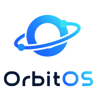

<p align="center">
  <picture>
    <source media="(prefers-color-scheme: dark)" srcset="orbitos/branding/extra/logo-stacked-dark.svg">
    
  </picture>
</p>

# OrbitOS

*[Version française](README.fr.md)*

OrbitOS is an open-source IoT platform for Canada and beyond: connect devices, collect their data,
see it on dashboards and act on it with rules. It works in English and French, runs fully on your
own computer or server, and never sends data or usage information to anyone.

> **Status: version 1.0.** All six phases done; see [the final status report](orbitos/docs/status/FINAL_STATUS.md). Have a privacy lawyer or officer review it before production use. See [CHANGELOG.md](CHANGELOG.md).

## What makes it different

- **Local and private.** No telemetry, no update checks, no marketplace calls. Every outbound
  network call is listed in [UPSTREAM_PATCHES.md](UPSTREAM_PATCHES.md) and is off by default.
- **Your brand.** Name, logo, colors, login text and legal links come from one file:
  [`orbitos/branding/branding.yml`](orbitos/branding/branding.yml). See the
  [branding guide](orbitos/docs/en/branding.md).
- **Bilingual.** English and French (Canada and France) are first-class: screens, emails, dates.
- **Simple to run.** One command, about 1.3 GB of RAM, no default passwords, works offline.
- **Private and secure by default.** Two-factor sign-in, tamper-evident audit log, retention limits, privacy export and erasure (Law 25, PIPEDA).
- **Devices.** MQTT (also encrypted), HTTP, CoAP; Modbus, OPC UA and BACnet through an optional gateway add-on.
- **Open licence.** Apache License 2.0, forever. See [Licence](#licence).

## Quick start

You need Docker. In this folder:

```bash
docker compose up -d
```

The first start builds OrbitOS (15 to 30 minutes). Then open **http://localhost:8080**: the setup
page creates your account, your organization and a sample device with a dashboard. The setup code
it asks for is in the server log (`docker compose logs orbitos`).

Guides ([all of them](orbitos/docs/en/index.md), also in the app at `/docs`): [quick start](orbitos/docs/en/quick-start.md) · [install, backups, upgrades, HTTPS](orbitos/docs/en/install.md) · [connect devices](orbitos/docs/en/connect-devices.md) · [APIs and webhooks](orbitos/docs/en/api.md) · [privacy and security](orbitos/docs/en/privacy-security.md).

## Licence

OrbitOS is licensed under the [Apache License 2.0](LICENSE).

OrbitOS is a fork of [ThingsBoard](https://github.com/thingsboard/thingsboard) Community Edition
4.3.1.6, the last Apache-2.0 release line. It does not contain code from ThingsBoard 4.4 or later,
which use a different licence. OrbitOS is not affiliated with or endorsed by ThingsBoard, Inc.
See [NOTICE](NOTICE) and [UPSTREAM_PATCHES.md](UPSTREAM_PATCHES.md).

## Support

OrbitOS is free and provided as is, without warranty (Apache License 2.0). Help comes from the community:
ask questions and report bugs in [GitHub Issues](../../issues). Security problems: privately, see [SECURITY.md](SECURITY.md).

## Security

See [SECURITY.md](SECURITY.md).
